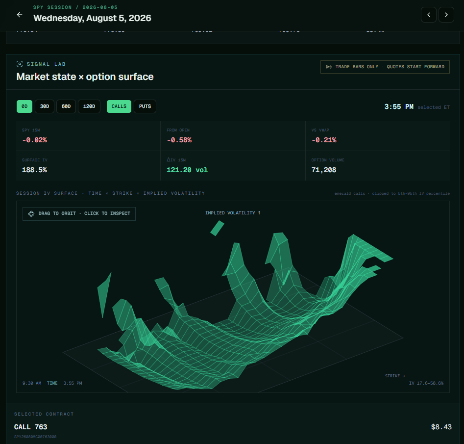

# SPY Macro Lab

Cache-first Python tooling for a research dataset containing one-minute SIP SPY prices,
five-minute SPY option bars, and the expirations nearest 0, 30, 60, and 120 calendar days.



Signal Lab: market metrics and the session's option implied-volatility surface.

## Why Python + SQLite

Python has the deepest ecosystem for options research, statistics, and notebooks.
SQLite is local, portable, queryable without a server, and easy to expose through
a future FastAPI/browser UI. Raw downloads are normalized into tables and each
completed request unit is logged, so rerunning the collector does not redownload it.

## Run

Use Python 3.11+ from the repository root:

```powershell
$env:PYTHONPATH = "src"
python -m spy_macro_data.cli check
python -m spy_macro_data.cli collect --start 2025-08-29 --end 2026-08-29
python -m spy_macro_data.cli rich --start 2025-08-29 --end 2026-08-29
python -m spy_macro_data.cli features --start 2025-08-29 --end 2026-08-29
python -m spy_macro_data.cli summary
```

The default database is `data/market_data.sqlite`. `secrets.txt` and `data/` are
gitignored. The secrets file accepts `key=...`, `secret=...`, and `endpoint=...`
(colon separators are also accepted).

## Selection definition

For each SPY market day, the first regular-session hourly close is used as spot.
For each target DTE, the nearest listed expiration on or after that market date is
selected. For calls and puts separately, the collector chooses the closest 12
strikes below spot and closest 12 strikes at/above spot. The stored `side` is
deliberately `below_spot`/`above_spot`; ITM/OTM can then be derived correctly for
calls and puts without ambiguity.

The rich pass stores one-minute SIP underlying bars and five-minute trade-derived option
OHLCV. Because Alpaca's historical bar endpoint does not include Greeks, the app derives
IV and Greeks locally with Black–Scholes (4.25% risk-free rate, 1.2% dividend yield).
SPY options are American-style, so these values are labeled as research estimates.
Open interest and contract close fields are normalized from the contract catalog.

## Browse the data

The local web app provides a calendar overview, full-day SPY and option charts, and
notes stored in the same SQLite database. Start both local services with:

```powershell
.\start_app.ps1
```

Then open `http://localhost:3000`. The app stays local and reads
`data/market_data.sqlite`; it does not upload the market data or notes.
The startup script also runs a market-hours recorder every minute for the configured
option quote feed. The default is Alpaca's indicative feed. After signing Alpaca's
OPRA agreement, add `option_feed=opra` to `secrets.txt` to store consolidated OPRA
bid/ask snapshots instead. The UI always identifies the source and never substitutes
trade prices for missing quotes.
To capture once or run it separately:

```powershell
$env:PYTHONPATH = "src"
python -m spy_macro_data.cli snapshot
python -m spy_macro_data.cli snapshot --interval 60
```

The `features` command materializes a research-ready row for every selected five-minute
option bar: SPY 5/15/30-minute momentum, move from the open, cumulative VWAP distance,
distance from the intraday high and low, option momentum, IV changes, DTE, moneyness,
volume/trade count, nearby catalyst categories, and any captured bid/ask spread. The
daily page exposes these rows through the interactive Signal Lab.

Alpaca Basic permits historical requests but delays recent SIP/OPRA data. A recent day
that still requires an OPRA agreement is left incomplete and retryable; rerun `rich`
later and only the missing date will be requested.

Historical macro news is cached with the same credentials and is resumable:

```powershell
$env:PYTHONPATH = "src"
python -m spy_macro_data.cli news --start 2025-08-29 --end 2026-08-29
```

For each market day, the collector provides continuous 7:00 AM–8:00 PM Eastern
coverage. The gaps between the original four windows are split at their midpoint,
so articles are assigned to the nearest slot: 7:00–10:15 AM, 10:15 AM–1:00 PM,
1:00–3:30 PM, and 3:30–8:00 PM. It scans up to 50 candidates per slot and stores
no more than the 10 strongest relevant matches.
